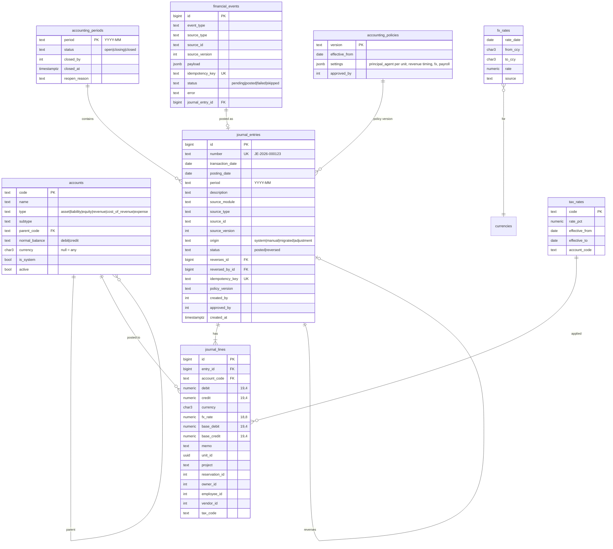

# Accounting ERD (target, new tables only)

Existing tables keep their role as **sources** (reservations, payments, expenses, petty_cash, vendor_invoices, owner_payout_requests, staff_payroll_entries, …). Two columns are added to reservations in Phase 2: `company_commission_pct_snapshot`, `agent_commission_pct_snapshot` (decision D-12).
